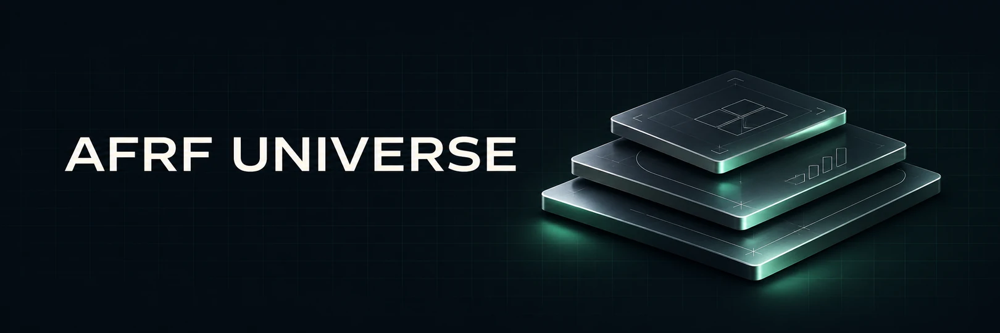

# Alireza Foroughifar

**Full-stack product and systems engineer based in Cyprus**

I build Windows desktop apps and business systems that turn spreadsheet-heavy work into clear, repeatable workflows. My work covers the full path from understanding an operation to designing, shipping, and running the software it depends on.

[LinkedIn](https://www.linkedin.com/in/alireza-foroughifar/) · [YouTube tutorials](https://www.youtube.com/@alirezaforoughifar) · [Public repositories](https://github.com/afrfuniverse?tab=repositories)

## Free Windows apps

| App | What it does | Install and learn |
| --- | --- | --- |
| [**GPOCasebook**](https://github.com/afrfuniverse/gpocasebook) | Investigate Group Policy failures on Windows. Compare before-and-after captures and export an offline evidence report. | [Microsoft Store](https://apps.microsoft.com/detail/9N6D294Z5PMZ) · [Demo](https://youtu.be/UiXlY1ROzfM) |
| [**AFRF Cashbook Lite**](https://github.com/afrfuniverse/afrf-cashbook-lite) | Record cash receipts and payments offline, track balances by currency, and export filtered reports to Excel. | [Microsoft Store](https://apps.microsoft.com/detail/9P256QR4DXKQ) · [Demo](https://youtu.be/v4RI3hX917w) |
| [**AFRF Backup Verify**](https://github.com/afrfuniverse/afrf-backup-verify) | Compare an original folder with its backup, flag missing or changed files, and check for damage in supported formats. | [Microsoft Store](https://apps.microsoft.com/detail/9MVT2078XCW2) · [Demo](https://youtu.be/AWULw6d47NA) |

### Coming soon · AFRF PeopleDesk

An offline Windows workspace for personnel records, attendance, employment contracts, and payroll preparation. It includes contract and letter templates, PDF and Excel exports, encrypted backups, and English, Persian, Turkish, Russian, and Arabic interfaces. Planned as a free Microsoft Store download.

[Product page and tutorials](https://github.com/afrfuniverse/afrf-peopledesk) · [English teaser](https://www.youtube.com/shorts/k8I2-XgQqOo) · [تیزر فارسی](https://www.youtube.com/shorts/k5QlSPfGSdE)

## Business systems

**Öztemur ERP** brings accounting, CRM, inventory, purchasing, projects, and contracts into one self-hosted, multi-company workspace. I built it with React, TypeScript, and Supabase/PostgreSQL. It supports company-level access controls, multiple currencies, and Excel and PDF reports.

| Area | Selected systems |
| --- | --- |
| Finance and operations | **KASA Finance** for cash, bank and cheque reconciliation · **Logycy ERP** for logistics and settlement |
| Production and inventory | **Metalux ERP** for aluminium quoting and planning · **Mermer ERP** for marble sales and stock |
| Workforce | **Öztemur Puantaj** and **Hardworker ERP** for attendance, payroll, and field-team workflows |

More projects

- **Dropship Control MVP** and **Detailing Platform** cover supplier intake, fulfillment, bookings, and customer operations.
- **AFRF Smart VMS Web** brings camera feeds, PTZ controls, and location permissions into a Windows-first workspace.
- **MyQRCodePlus** manages dynamic QR links. **EMOSEM** supports content scheduling and Telegram delivery.
- **AFRF Universe** is my multilingual technical showcase. **BeyazSiyah** is a Turkish and English product comparison platform. [Visit BeyazSiyah](https://beyazsiyah.com)

Client production systems are privately maintained. The public repositories here contain tools, documentation, or sample data intended for sharing.

## Public engineering tools

- [**VolumeWitness**](https://github.com/afrfuniverse/volumewitness) checks whether the next Docker Compose deployment would switch database volumes.
- [**ClockSkewProof**](https://github.com/afrfuniverse/clockskewproof) checks whether captured clock skew could explain a TLS or Kerberos timing result.
- [**SMBProof**](https://github.com/afrfuniverse/smbproof) verifies expected read access to a test file from a specific Windows logon.

I work with **C#/.NET and WPF** for Windows, **React and TypeScript** for web, and **PostgreSQL, Supabase, Docker, and Linux** for data and delivery.

## ارتباط و آموزش

ابزارهای ویندوزی و سامانه‌های سازمانی می‌سازم. برنامه‌های رایگان بالا در Microsoft Store در دسترس‌اند و آموزش‌ها و معرفی نسخه‌های تازه را در یوتیوب منتشر می‌کنم. [کانال یوتیوب](https://www.youtube.com/@alirezaforoughifar)

[LinkedIn](https://www.linkedin.com/in/alireza-foroughifar/) · [Instagram](https://www.instagram.com/alirezafrf/) · [Facebook](https://www.facebook.com/Alirezafrf) · [Threads](https://www.threads.com/@alirezafrf)
